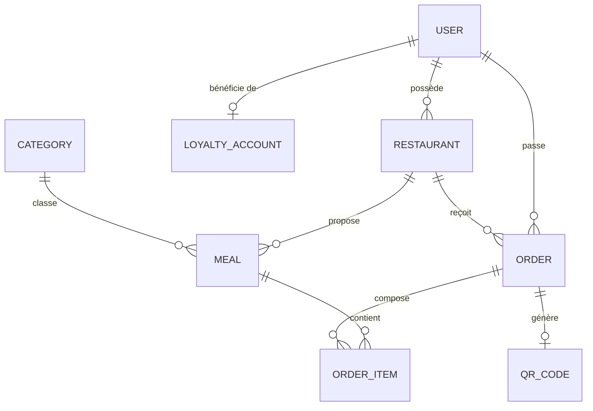

# 🍽️ SaveMyMeal — Documentation Backend API

Bienvenue dans la documentation complète du backend **SaveMyMeal**. 
Cette API RESTful a été conçue avec **ASP.NET Core (.NET 10)** et **Entity Framework Core (Oracle DB)** pour alimenter une plateforme anti-gaspillage alimentaire connectant commerçants/restaurateurs et consommateurs.

---

## 📋 Table des Matières
1. [Architecture & Technologies](#-architecture--technologies)
2. [Modèle de Données & Entités](#-modèle-de-données--entités)
3. [Sécurité & Authentification](#-sécurité--authentification)
4. [Algorithme de Tarification Intelligente (Smart Discount)](#-algorithme-de-tarification-intelligente-smart-discount)
5. [Système de Fidélité & Retrait par QR Code](#-système-de-fidélité--retrait-par-qr-code)
6. [Guide des Endpoints API](#-guide-des-endpoints-api)
7. [Commandes de Test (Ajout de Plats & Scénario Complet)](#-commandes-de-test-ajout-de-plats--scénario-complet)

---

## 🏗️ Architecture & Technologies

- **Runtime & Framework** : .NET 10.0 / ASP.NET Core Web API
- **Base de Données** : Oracle Database (connexion via `Oracle.EntityFrameworkCore`)
- **Sécurité** : JWT Bearer Token (`Microsoft.AspNetCore.Authentication.JwtBearer`) + Hachage PBKDF2 avec SHA256 et Salt 128-bit
- **Documentation OpenAPI** : `Microsoft.AspNetCore.OpenApi` disponible sur `/openapi/v1.json`
- **Architecture Applicative** : Modèle en couches :
  - **Controllers** : Réception des requêtes HTTP, validation des DTOs, gestion des codes d'état REST.
  - **Services** : Logique métier pure (tarification dynamique, vérification des stocks, points fidélité, QR codes).
  - **Data / EF Core** : `AppDbContext` avec mappings relationnels, index uniques et contraintes d'intégrité.
  - **DTOs** : Contrats d'échange stricts pour isoler les entités internes de l'API publique.

---

## 🗄️ Modèle de Données & Entités



1. **User** (`Users`) : Comptes utilisateurs (`Admin`, `Restaurant`, `Client`).
2. **Restaurant** (`Restaurants`) : Fiche établissement avec adresse, téléphone et commerçant propriétaire (`OwnerId`).
3. **Category** (`Categories`) : Catégorie d'aliments (Boulangerie, Plats chauds, Panier surprise, etc.).
4. **Meal** (`Meals`) : Repas ou paniers anti-gaspi proposés avec prix initial, prix remisé standard, quantité disponible et date limite de consommation (`ExpiryDate`).
5. **Order** (`Orders`) : Commande passée par un client avec statut (`Pending`, `Confirmed`, `Completed`, `Cancelled`), prix total et remise appliquée.
6. **OrderItem** (`OrderItems`) : Lignes de commande détaillant chaque plat, quantité et prix unitaire figé au moment de l'achat.
7. **QrCode** (`QrCodes`) : Jeton unique généré pour sécuriser le retrait du panier en magasin (`IsUsed = true` dès validation).
8. **LoyaltyAccount** (`LoyaltyAccounts`) : Compte de fidélité crédité en *SavePoints* (50 points offerts à l'inscription, 1 point par euro dépensé, 20 points = 1€ de réduction).

---

## 🔒 Sécurité & Authentification

- **Mots de passe** : Aucune donnée en clair. Utilisation de la fonction de dérivation `Rfc2898DeriveBytes.Pbkdf2` avec 100 000 itérations, SHA-256 et sel cryptographique aléatoire de 16 octets.
- **Tokens JWT** : Génération de jetons conformes standard RFC 7519 contenant les claims essentiels :
  - `nameid` : Identifiant de l'utilisateur
  - `unique_name` : Nom d'utilisateur
  - `email` : Adresse e-mail
  - `role` : Rôle d'accès (`Client`, `Restaurant`, `Admin`)
- **Contrôle d'accès** : Les routes sensibles utilisent l'attribut `[Authorize]` ou vérifient le rôle et l'identité du client connecté.

---

## 💡 Algorithme de Tarification Intelligente (Smart Discount)

Pour maximiser le sauvetage des repas avant leur péremption, le service `SmartDiscountService` évalue en temps réel le nombre d'heures restantes :
$$\text{Heures Restantes} = \text{ExpiryDate} - \text{DateTime.UtcNow}$$

| Temps restant avant péremption | Niveau d'urgence | Réduction appliquée | Description |
| :--- | :--- | :--- | :--- |
| **$\le$ 1h30** | `Flash Sale` | **-75%** | Sauvetage d'extrême urgence avant fermeture |
| **$\le$ 3h00** | `Critique` | **-60%** | Panier à sauver rapidement |
| **$\le$ 6h00** | `Modéré` | **-50%** | Remise intermédiaire attractive |
| **$> 6$h00** | `Standard` | Prix remisé standard | Remise initiale fixée par le commerçant |

*Règles de sécurité :* Le prix calculé ne dépasse jamais le prix commerçant et respecte un plancher symbolique de 1,00 €.

---

## 🎁 Système de Fidélité & Retrait par QR Code

### 1. Programme SavePoints
- **Bienvenue** : 50 SavePoints offerts à la création du compte.
- **Récompense** : 1 point par euro dépensé + 5 points bonus anti-gaspi par commande.
- **Conversion** : 20 SavePoints = 1,00 € de remise déductible directement sur la commande suivante.

### 2. Retrait Sécurisé par QR Code
Lorsqu'une commande est passée :
1. Un code QR unique au format `SMM-ORD-{OrderId}-{HASH}` est généré.
2. Le client présente ce code sur son smartphone lors du retrait.
3. Le commerçant appelle `POST /api/qrcodes/validate`. Le système valide la correspondance avec le restaurant, vérifie que le panier n'a pas déjà été retiré, consomme le QR code et passe la commande en `Completed`.

---

## 📡 Guide des Endpoints API

### Authentification (`/api/auth`)
- `POST /api/auth/register` : Créer un nouveau compte utilisateur.
- `POST /api/auth/login` : Se connecter et obtenir un token JWT.
- `GET /api/auth/me` : Obtenir les informations du profil connecté `[Authorize]`.

### Plats & Paniers (`/api/meals`)
- `GET /api/meals` : Liste des repas disponibles (filtrable par `categoryId`, `restaurantId`, `onlyAvailable`).
- `GET /api/meals/{id}` : Détails d'un repas.
- `GET /api/meals/restaurant/{restaurantId}` : Tous les plats d'un restaurant spécifique.
- `POST /api/meals` : Ajouter un plat / panier anti-gaspi.
- `PUT /api/meals/{id}` : Modifier un plat existant.
- `DELETE /api/meals/{id}` : Supprimer un plat.

### Offres Anti-Gaspillage (`/api/offers`)
- `GET /api/offers` : Liste des repas en déstockage avec calcul du Smart Discount en temps réel, triés par urgence.
- `GET /api/offers/{mealId}/smart-price` : Simuler le prix intelligent actuel d'un plat.

### Commandes (`/api/orders`)
- `POST /api/orders` : Passer commande d'un ou plusieurs paniers (décrémente les stocks et génère le QR code).
- `GET /api/orders/{id}` : Détails de la commande et son QR code.
- `GET /api/orders/user/{clientId}` : Historique des commandes d'un client.
- `GET /api/orders/restaurant/{restaurantId}` : Commandes reçues par un restaurant.
- `PATCH /api/orders/{id}/status` : Changer le statut d'une commande.
- `POST /api/orders/{id}/cancel` : Annuler une commande et réapprovisionner les stocks.

### Validation QR Code (`/api/qrcodes`)
- `GET /api/qrcodes/order/{orderId}` : Récupérer le QR code d'une commande.
- `POST /api/qrcodes/validate` : Valider le retrait en restaurant.

### Programme de Fidélité (`/api/loyalty`)
- `GET /api/loyalty/{userId}` : Consulter le solde et l'équivalent en euros.
- `POST /api/loyalty/{userId}/redeem` : Convertir des points en bon d'achat.
- `POST /api/loyalty/{userId}/add` : Créditer des points (bonus/promo).

### Restaurants (`/api/restaurants`)
- `GET /api/restaurants` : Liste des établissements partenaires.
- `GET /api/restaurants/{id}` : Détails d'un établissement.
- `POST /api/restaurants` : Enregistrer un nouveau restaurant.
- `PUT /api/restaurants/{id}` : Modifier les coordonnées.
- `DELETE /api/restaurants/{id}` : Supprimer un établissement.

### Utilisateurs (`/api/users`)
- `GET /api/users` : Liste des utilisateurs.
- `GET /api/users/{id}` : Profil d'un utilisateur.
- `PUT /api/users/{id}` : Mise à jour des informations.
- `DELETE /api/users/{id}` : Suppression de compte.

---

## 🧪 Commandes de Test (Ajout de Plats & Scénario Complet)

Voici les commandes `cURL` prêtes à l'emploi pour tester l'ajout de plats et l'ensemble du cycle de vie de l'application (en supposant le serveur démarré sur `http://localhost:5106`) :

### 1. Inscription d'un Restaurateur
```bash
curl -X POST http://localhost:5106/api/auth/register \
  -H "Content-Type: application/json" \
  -d '{
    "username": "chef_mario",
    "email": "mario@pizzeria.com",
    "password": "Password123!",
    "role": "Restaurant"
  }'
```

### 2. Création du Restaurant
```bash
curl -X POST http://localhost:5106/api/restaurants \
  -H "Content-Type: application/json" \
  -d '{
    "name": "Trattoria Mario",
    "address": "12 Rue de la Paix, 75002 Paris",
    "phoneNumber": "0142680000",
    "ownerId": 1
  }'
```

### 3. Ajout de Plats / Paniers Anti-Gaspi
> [!TIP]
> Réglez la date `expiryDate` dans quelques heures par rapport à votre heure actuelle pour observer l'algorithme *Smart Discount* s'activer immédiatement !

#### Exemple A : Panier Boulangerie / Pâtisseries (Urgence Flash Sale : expire dans 1h)
```bash
curl -X POST http://localhost:5106/api/meals \
  -H "Content-Type: application/json" \
  -d '{
    "title": "Grand Panier Viennoiseries & Pains",
    "description": "Assortiment surprise : croissants, pains au chocolat, baguettes tradition.",
    "originalPrice": 18.00,
    "discountedPrice": 5.99,
    "quantity": 4,
    "expiryDate": "'$(date -u -v+1H +"%Y-%m-%dT%H:%M:%SZ" 2>/dev/null || date -u -d "+1 hour" +"%Y-%m-%dT%H:%M:%SZ")'",
    "restaurantId": 1,
    "categoryId": 1
  }'
```

#### Exemple B : Plat Cuisiné Traiteur (Urgence Critique : expire dans 2h30)
```bash
curl -X POST http://localhost:5106/api/meals \
  -H "Content-Type: application/json" \
  -d '{
    "title": "Lasagnes Bolognaise Maison",
    "description": "Portion individuelle préparée le matin avec ingrédients frais locaux.",
    "originalPrice": 12.50,
    "discountedPrice": 4.50,
    "quantity": 6,
    "expiryDate": "'$(date -u -v+2H +"%Y-%m-%dT%H:%M:%SZ" 2>/dev/null || date -u -d "+2 hours" +"%Y-%m-%dT%H:%M:%SZ")'",
    "restaurantId": 1,
    "categoryId": 1
  }'
```

#### Exemple C : Panier Sushi Mix (Urgence Modérée : expire dans 5h)
```bash
curl -X POST http://localhost:5106/api/meals \
  -H "Content-Type: application/json" \
  -d '{
    "title": "Plateau 18 Pièces Sushi & Maki",
    "description": "Saumon frais d'\''Écosse, thon et rolls avocat fromage.",
    "originalPrice": 22.00,
    "discountedPrice": 8.90,
    "quantity": 3,
    "expiryDate": "'$(date -u -v+5H +"%Y-%m-%dT%H:%M:%SZ" 2>/dev/null || date -u -d "+5 hours" +"%Y-%m-%dT%H:%M:%SZ")'",
    "restaurantId": 1,
    "categoryId": 1
  }'
```

---

### 4. Vérification des Plats et des Offres Dynamiques

#### Consulter la liste des repas actifs :
```bash
curl -X GET "http://localhost:5106/api/meals?onlyAvailable=true"
```

#### Consulter le flux des offres intelligentes anti-gaspi (*Smart Discounts*) :
```bash
curl -X GET "http://localhost:5106/api/offers"
```

---

### 5. Passer Commande et Retirer en Restaurant

#### Passer la commande (décrémente le stock et génère le QR Code) :
```bash
curl -X POST http://localhost:5106/api/orders \
  -H "Content-Type: application/json" \
  -d '{
    "clientId": 1,
    "restaurantId": 1,
    "items": [
      {
        "mealId": 1,
        "quantity": 1
      }
    ],
    "pointsToRedeem": 0
  }'
```

#### Valider le QR Code lors du retrait au restaurant :
```bash
curl -X POST http://localhost:5106/api/qrcodes/validate \
  -H "Content-Type: application/json" \
  -d '{
    "codeValue": "CODE_QR_RECU_DANS_LA_COMMANDE",
    "restaurantId": 1
  }'
```

---

## 🚀 Lancer le Backend

Pour lancer le serveur en développement :
```bash
cd /Users/mac1/RiderProjects/SaveMyMeal/Backend-SaveMyMeal
dotnet run
```
Accédez au statut de santé de l'API sur : `http://localhost:5106/` ou à la spécification OpenAPI sur `http://localhost:5106/openapi/v1.json`.
